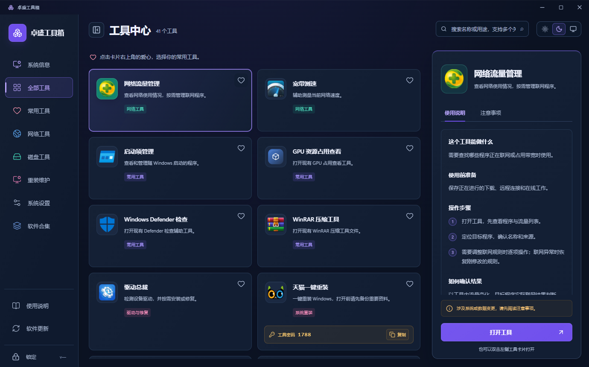
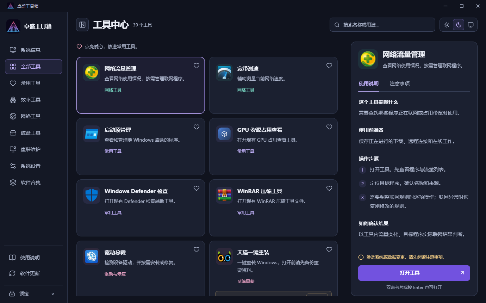
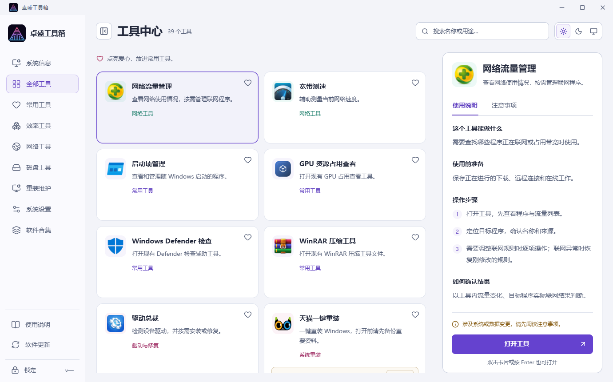
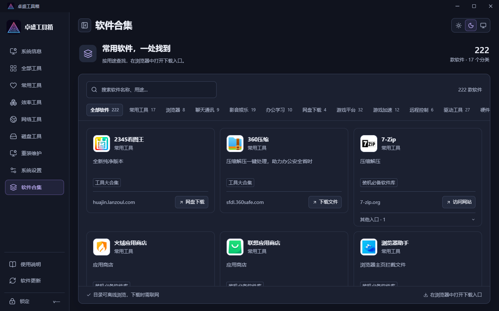
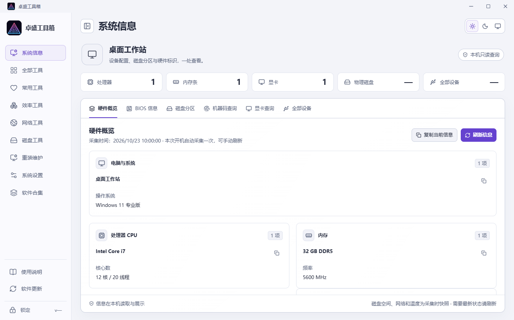

# 卓盛工具箱 UI、主题与交互优化记录

日期：2026-10-23。用户已审核任务清单并要求开始制作。

## 已实现

| Task | 结果 |
| --- | --- |
| T01 界面基线 | 已备份本轮涉及的源码、测试及宿主文件，并保存改动前截图。 |
| T02 主题字体 | 紫色品牌色搭配中性背景；深浅主题共用语义变量；正文、说明、状态字号提高，减少叠加覆盖和装饰。 |
| T03 窗口布局 | 重整侧栏、搜索、工具列表和详情比例；小窗口使用单列卡片；主操作固定在详情底部。 |
| T04 工具详情 | 保留单击查看、双击/Enter 打开和独立收藏/复制；增加失败重试、文件检查和日志入口。 |
| T05 系统信息 | 提高阅读密度与字段可读性，补充完全无数据的说明；保留开机缓存、手动刷新和失败旧值。 |
| T06 软件合集 | 分类栏改为横向滚动，减少首屏占用；提高卡片字号，增加 Logo 失败占位、上下文错误重试和列表位置恢复。 |
| T07 动画 | 统一反馈、切换与视图时长；主题和侧栏切换可打断；返回列表和搜索不反复播放整组入场；支持减少动态效果。 |
| T08 流程恢复 | 错误保留明确处理入口；主题保存失败不冒充持久化成功；文件多时允许较长检查并说明耗时。 |
| T09 运行状态 | 用请求代次防止旧轮询覆盖新启动结果；按会话隔离；隐藏时降低刷新频率，失败退避、恢复可见后同步。 |
| T10 React 组织 | 应用外壳、反馈、工具工作区与会话职责 Hook 分开；保持现有技术栈，无新增运行依赖。 |
| T11 界面规范 | 标签页键盘操作、关联面板、弹窗焦点范围和返回位置；等待时仍可聚焦；小图标按钮补足命中区域。 |
| T12 验证交付 | 已完成主要自动验证、截图与独立审查修复；最终结果见下表。Windows 实机显示缩放及安装升级为单独验收项。 |

现有系统重装两项边界、一次启动提示、锁定后的视图清空规则、只读系统信息、工具校验和更新签名机制均保留。本次没有执行第三方维护操作或发布安装包。

同目录期间还有效率工具、公司 Logo 与版本元数据的其他改动，本轮保留并兼容；这些功能与版本不记作本轮新增成果。

## 验证结果

| 验证 | 结果与边界 |
| --- | --- |
| 前端构建 | 成功，产物位于 `assets/web`。 |
| 完整前端回归 | 71 / 71 通过，含文件检查超时回归及两种渲染比例。 |
| 宿主逻辑 | 23 / 23 通过；按实际构建元数据传入预期版本，避免使用过期固定值。 |
| 无害进程树验证 | 8 / 8 通过。测试使用自建等待程序，未运行原维护工具。 |
| 主题保存 | 2 / 2 通过；占用文件会报告失败，原设置不变，使用临时文件后替换。 |
| 原生系统信息 WebView2 | 5 / 5 通过，包含真实系统报告、查询中切页、无盘符分区、显卡支持状态和锁定取消查询。 |
| 通用 WebView2 界面 | 6 / 6 通过，包含真实登录、39 项目录、收藏、完整文件检查、锁定和阻止外部页面导航。 |
| 页面与尺寸 | 浅深主题；1000×700、1366×768、1920×1080；另外既有回归覆盖 980×650 与窄网页视口。 |
| 渲染比例 | 1.25 和 1.5 下的小窗口主操作与布局检查通过。这是浏览器渲染比例测试，不是更改 Windows 显示设置。 |
| 目视检查 | 已查看工具中心、软件合集、系统信息、小窗口及两种主题截图；使用本地浏览器再次核对主界面。 |
| 机械检查 | Impeccable 检出一处粗侧边框，已改成语义化错误区域；没有宣称完整设计评分。 |

构建仍显示 `src/Shared/InstallPathPolicy.cs` 的既有可空性警告，本轮未调整该安装路径逻辑。

## 已验证并修复的问题

- 旧轮询在启动完成后返回，覆盖新的运行状态。
- 文件或启动失败只给出短暂提示，缺少就近重试和检查入口。
- 列表返回后位置丢失；从长列表筛到短列表时，布局清理又把旧位置记录为 0。
- 详情标签页缺少方向键和面板关联。
- 启动提示和驱动提醒的按钮变成忙碌禁用状态后，焦点可能离开弹窗。
- 小窗口出现很长的原生错误信息时，详情底部按钮被挤出裁切区域。
- 主题预览与偏好持久化失败没有明确区分。
- 软件入口失败后的回调不应留在已经离开的浏览上下文。
- 39 项真实工具文件检查需要约 35.36 秒，原宿主 30 秒上限不足。只读核对得到 39 / 39 文件完整；现改为宿主 120 秒、页面等待 150 秒，仍可在锁定时取消。原生验证相应延长等待，普通交互仍使用原等待时间。

上述交互问题都通过失败场景验证后修复。独立代码审查报告的三个 Important 问题，分别有对应的四项失败→通过回归；小按钮命中范围也已补齐。

图标批量解码检查曾在并行原生构建期间超时，隔离复核通过；最终以单独完整前端回归结果为准，不把某次超时隐藏成通过。

## 界面对照

改动前：

改动后：

系统信息对照图使用明确的测试设备数据；真实宿主查询验证使用了本机数据，但未将机器标识放进这些展示图。

## 文件与后续验收

- 审核任务依据：`docs/superpowers/plans/2026-10-23-ui-ux-review-tasks.md`。
- 实施与取舍记录：`.build/ui-ux-20261023/progress.md`。
- 完整日志与原始截图：`.build/ui-ux-20261023/evidence/`。
- 源码回退副本：`.build/ui-ux-20261023/baseline/`。当前目录没有 Git 仓库，因此没有创建分支或提交，也未更改其他任务的版本和发布状态。
- Windows 125% / 150% 显示设置下的实机验收、全新安装与旧版覆盖升级，继续作为单独验收，不由浏览器截图或构建成功替代。
- 文件完整性与进程启动证据不证明第三方维护功能成功或安装包通过安全发布验收。本次未改动随包第三方程序。
